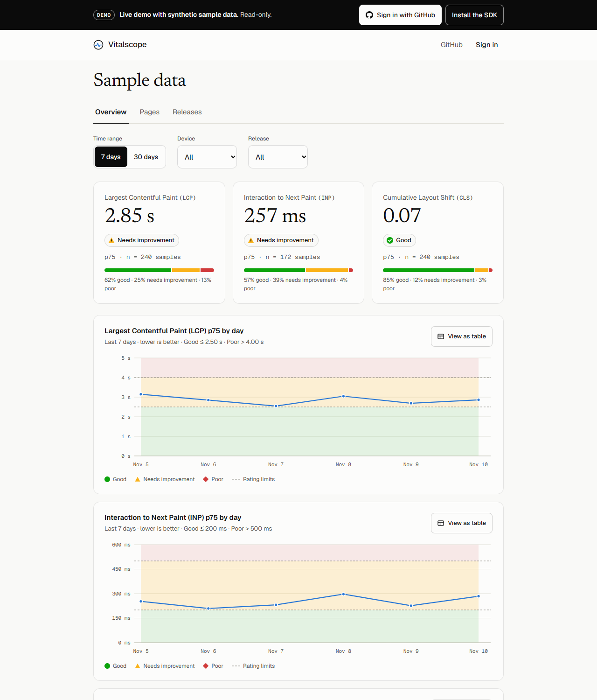
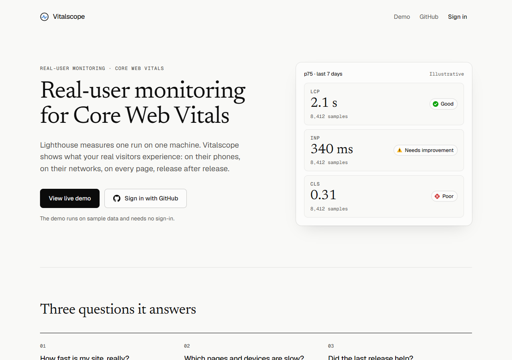
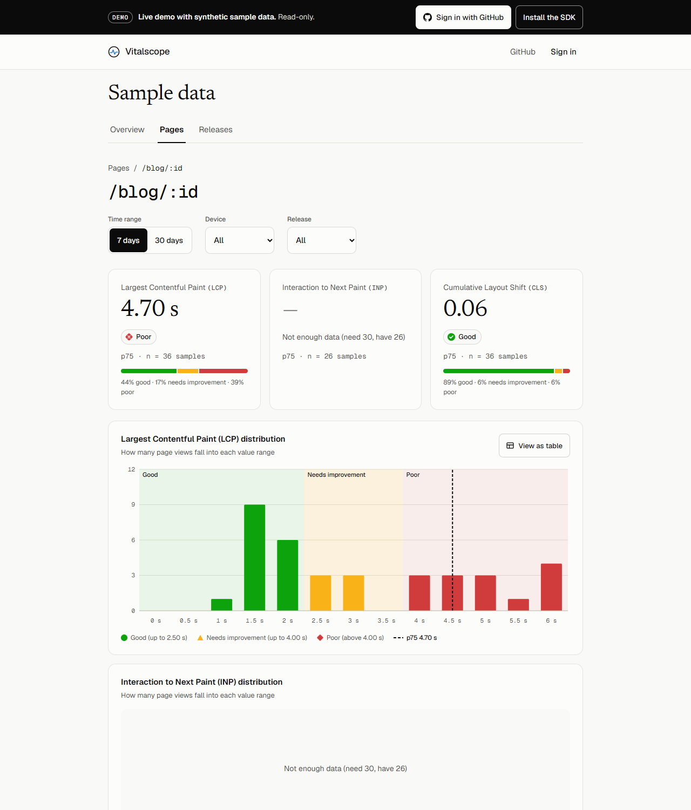
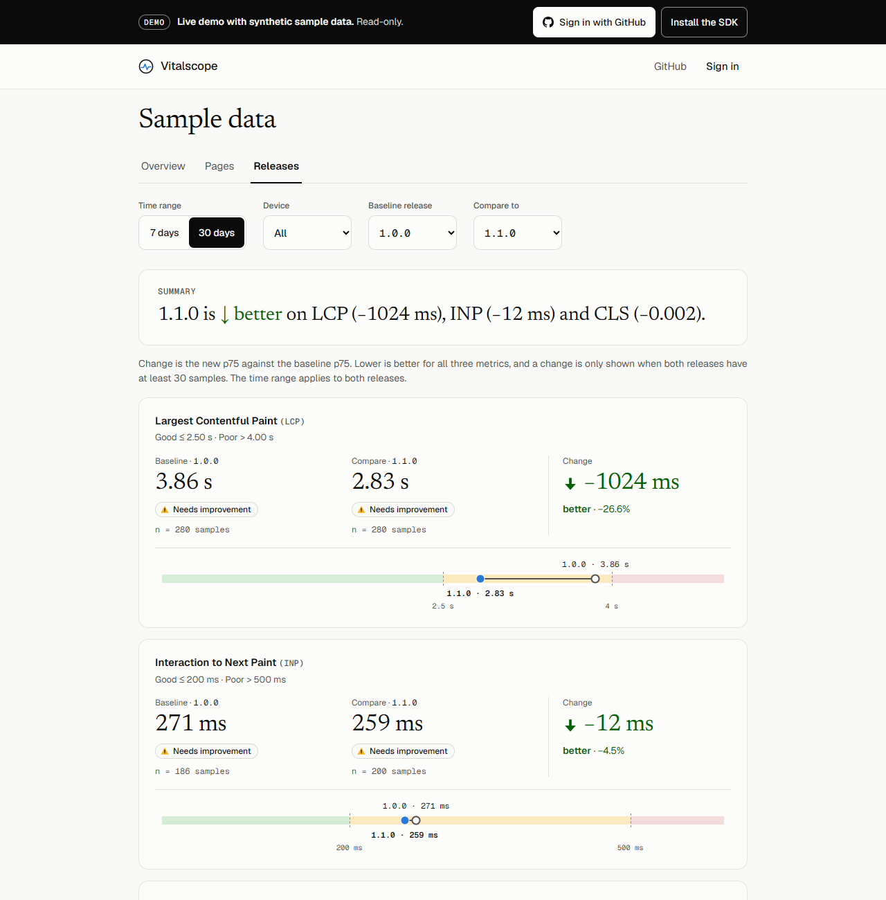
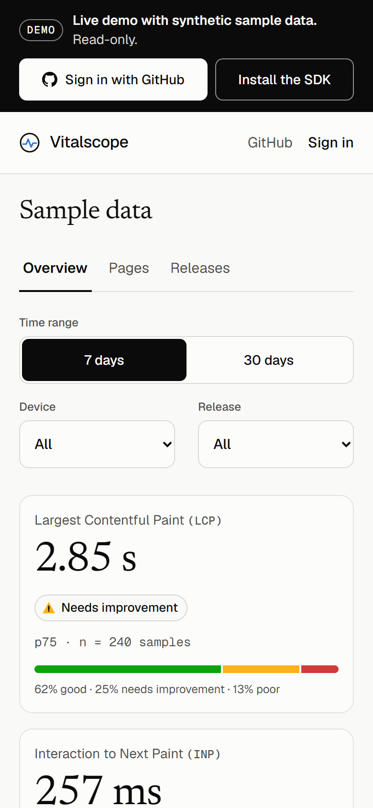

# Vitalscope

[](https://github.com/praveen-raj-r/vitalscope/actions/workflows/ci.yml)
[](https://www.npmjs.com/package/@praveen-raj/vitalscope)
[](LICENSE)

**Real-user monitoring for Core Web Vitals.** A tiny SDK measures how fast your pages are for real visitors, and a dashboard shows p75 LCP, INP and CLS by page, device and release.

**[Try the live demo](https://vitalscope-rum.vercel.app/demo)** (sample data, no sign-in)



<details>
<summary>More screenshots</summary>









</details>

All screenshots are the public demo, which runs on synthetic data.

## What you get

- **How fast is my site, really?** The 75th-percentile LCP, INP and CLS, rated good, needs improvement or poor.
- **Which pages and devices are slow?** A table of pages, worst first, with the slow element or interaction behind each number.
- **Did the last release help?** Two releases side by side, with the change and the sample size, so you know when to trust it.

## Quick start

```bash
npm install @praveen-raj/vitalscope
```

Create a site in the dashboard to get your public site key, then:

```ts
import { init } from '@praveen-raj/vitalscope';

init({ siteKey: 'vs_pub_your_site_key', release: '1.0.0' });
```

- **Under 5 KB gzipped**, including `web-vitals` (4.72 KB ESM, measured). CI fails if it grows past the budget.
- **Never throws**, sets no cookies, stores no IP addresses, and sends one beacon when the page is hidden.
- The default endpoint is the hosted deployment; pass `endpoint` to use your own.

More in the [SDK README](packages/sdk/README.md).

## How it works

```
 visitor's browser                    Vercel (Next.js)                     Supabase (Postgres)
┌──────────────────┐   one beacon   ┌─────────────────┐   service role   ┌──────────────────┐
│  SDK + web-vitals│ ─────────────▶ │  /api/ingest    │ ───────────────▶ │  events          │
└──────────────────┘  on page hide  │  validate, rate │                  │  daily_rollups   │
                                    │  limit, origin  │                  └────────┬─────────┘
┌──────────────────┐   SQL (RLS)    ├─────────────────┤   rpc, as the user        │
│  Dashboard / demo│ ◀───────────── │  server-rendered│ ◀─────────────────────────┘
└──────────────────┘                │  pages          │      /api/cron/daily rolls up
                                    └─────────────────┘      each day, deletes after 30
```

| Part | Where | Notes |
|---|---|---|
| SDK | [`packages/sdk`](packages/sdk) | TypeScript, tsup, published to npm |
| Dashboard, ingest, cron | [`apps/web`](apps/web) | Next.js 16, React 19, Tailwind 4, Recharts |
| Database | [`supabase/`](supabase) | Migrations, row-level security, pgTAP tests |
| Demo page for tests | [`apps/demo`](apps/demo), [`apps/e2e`](apps/e2e) | Vite page driven by Playwright |

## Run it locally

```bash
pnpm install
cp apps/web/.env.example apps/web/.env.local   # fill in Supabase values
npx supabase start                              # needs Docker
pnpm --filter @vitalscope/web dev
```

Tests: `pnpm test` (unit), `pnpm e2e` (real browser), and the pgTAP tests under `supabase/tests`. Everything else, such as GitHub sign-in, sample data, Sentry and the daily job, is in the **[development guide](docs/development.md)**.

## Design choices worth knowing

The full list, with the cost of each, is in **[docs/decisions.md](docs/decisions.md)**. The ones that shape the most:

- **Rollups use a SQL `CUBE`.** A percentile can't be combined across rows, so every filter combination gets its own row. On a quiet site rollups are not smaller than the raw events; they pay off for history and busy pages. ([details](docs/decisions.md#rollups-and-retention))
- **One row per page view and metric.** CLS and INP can be reported again, and counting each report would count a visit several times. ([details](docs/decisions.md#ingest-apiingest))
- **A number backed by under 30 samples is never given a verdict.** One threshold, `MIN_SAMPLES`, for every screen. ([details](docs/decisions.md#dashboard-numbers))
- **The public demo reads sample data with the service role, from one fixed site id.** The safety rests on that id, not on the URL. ([details](docs/decisions.md#data-model-and-security))
- **The Origin check ties a key to a website; it is not authentication.** Rate limiting and validation matter too. ([details](docs/decisions.md#ingest-apiingest))
- **Sentry collects nothing beyond the error itself.** Cookies, headers, user and IP are all switched off. ([details](docs/decisions.md#quality-and-operations))

## Status

All six build weeks are done: SDK, ingest, dashboard, release comparison, rollups, public demo, end-to-end test, Sentry and the npm release. The [spec](vitalscope-spec.md) lists what was asked for. Known gaps: no dark mode, no custom domain yet (the SDK's default endpoint is the Vercel address), and the in-memory rate limiter is per serverless instance.

## License

[MIT](LICENSE)
